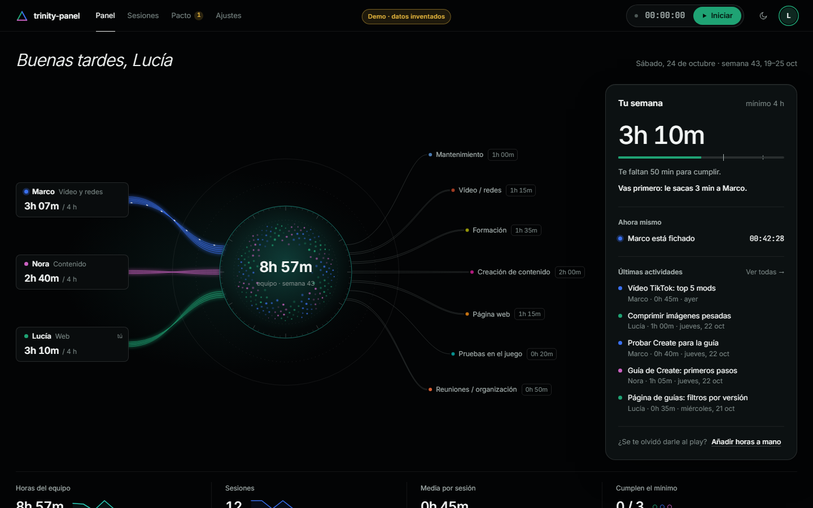
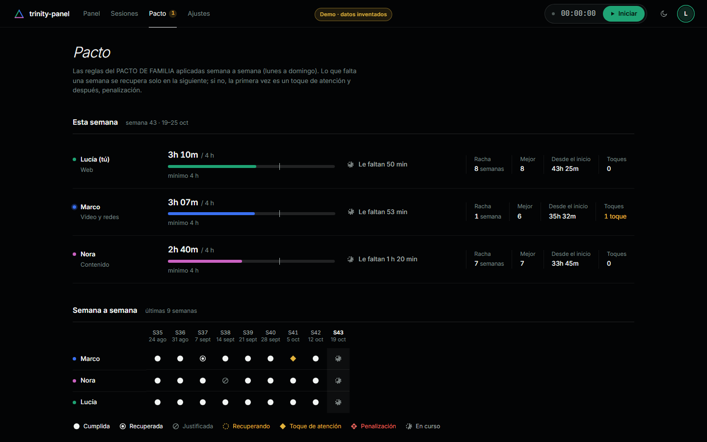
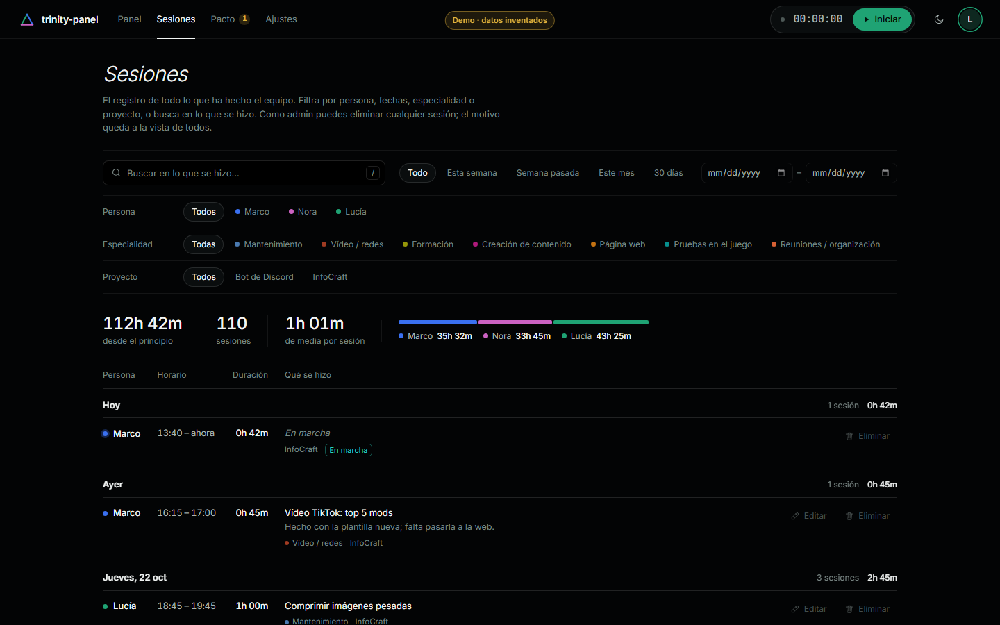
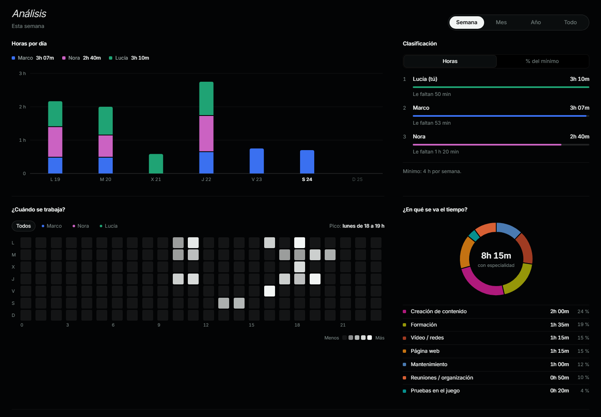

# trinity-panel

Private time-tracking web app for a three-person team that works under a shared weekly-hours pact.

[](https://github.com/AketzaBarajas/trinity-panel/actions/workflows/ci.yml)
[](LICENSE)



## Overview

TRINITY is a team of three that agreed on a pact: at least 4 hours of work a week, a missed
week can only be made up the following week, absences must be announced 48 hours ahead, and
breaking the pact means a warning and then a penalty. Logging hours in a spreadsheet or a
Discord channel was easy to forget and impossible to check. trinity-panel records real time
with a server-side stopwatch and applies the pact rules automatically, so nobody has to act
as the accountant.

The interface and code comments are in Spanish, the team's language.

## Features

- **Server-side stopwatch:** the start time is stored in Postgres, so closing the tab or turning
  off the computer does not stop it. Sessions are cut automatically at 4 h, and hours added by
  hand are flagged until another admin validates them.
- **Pact rules in the database:** one SQL function works out every week's state for every
  member: met, made up, justified, warning or penalty.
- **Live team view:** who is working right now, updated in real time for all three members.
- **Analytics:** hours per day stacked by member, day × hour heatmap, time per specialty,
  day timeline and a yearly activity calendar, all drawn in SVG.
- **Global log:** search and filter every session by person, dates, specialty and project.
  Totals cover the whole filter, and the filters live in the URL so a view can be shared.
- **Discord notices and backups:** start/finish messages, a Sunday summary and a Thursday
  reminder, sent from Postgres with `pg_cron` + `pg_net`; a weekly backup downloadable as JSON.
- **Installable PWA** that starts from cache, plus a **demo mode** that runs the real
  migrations in an in-browser Postgres with made-up data.

| Pact | Global log | Analytics |
|---|---|---|
|  |  |  |

All screenshots use demo mode (made-up members and data).

## Tech stack

| Layer | Technology |
| ----- | ---------- |
| Frontend | SvelteKit 3 (static SPA), Svelte 5, TypeScript |
| Backend | Supabase: Postgres, Row Level Security, SQL functions, Realtime |
| Auth | Discord OAuth with a closed list of accounts |
| Automation | `pg_cron` + `pg_net` (Discord webhook, backups) |
| Hosting | Cloudflare Pages, service worker |
| Tests | Node test runner + PGlite (Postgres in WebAssembly) |

## Getting started

Requirements: Node.js 22.18 or newer.

**Try it without a backend (demo mode):**

```bash
git clone https://github.com/AketzaBarajas/trinity-panel.git
cd trinity-panel
npm ci
npm run dev
```

Open <http://localhost:5173/?demo>. The app loads every migration from `supabase/migrations/`
into an in-browser Postgres with three made-up members and nine weeks of sessions. Demo mode
only exists in the dev server and is stripped from the production build.

**Run it for real:** create a Supabase project and a Discord application, run the migrations in
order and copy `.env.example` to `.env`. The full step-by-step guide, including how to verify
each phase, is in [docs/SETUP.es.md](docs/SETUP.es.md) (Spanish).

```bash
npm run build        # static site in build/
npx wrangler pages deploy build --project-name <your-project>
```

## Testing

```bash
npm test             # database tests
npm run check        # type check (svelte-check)
```

`npm test` applies every migration to an in-memory Postgres (PGlite), loads the demo data and
checks the rules: made-up, justified and warned weeks, one running stopwatch per member, sub-1-minute
sessions being discarded, manual hours flagged for review, no self-review, the 48-hour notice for
absences, Discord notices sent only once and webhook URL validation (12 tests, passing on
24 October 2026). There are no browser end-to-end tests yet.

Lighthouse on the login page (production build, 24 October 2026): 100 performance /
100 accessibility / 100 best practices on desktop, 96 / 100 / 100 on mobile. The other pages
need a session and were not measured.

## Architecture

```text
src/
  routes/            pages: panel (/), sesiones, pacto, ajustes, login
  lib/               state (team, stopwatch, pact, stats), charts, components
  lib/demo/          demo mode: in-browser Postgres client and made-up data
  service-worker.ts  app-shell cache for the installable PWA
supabase/migrations/ the whole backend: tables, RLS, SQL functions, cron jobs
tests/               database tests (PGlite)
docs/                setup guide (ES), decision log, screenshots
```

- **The database is the backend.** The browser key is public, so hours are only ever written by
  SQL functions that use the server clock, and Row Level Security decides who can read and write.
  The web app only displays data and reports errors.
- **The pact rules are one SQL function** (`pact_status`), so the pact page, the dashboard and
  the Discord summary always agree.
- **Notices without a server.** A `pg_cron` job runs every minute and posts to Discord with
  `pg_net`. A log table with a unique key per notice makes sending idempotent. The webhook URL
  lives in a schema the API cannot read.
- **Demo mode reuses the real migrations** instead of mock data, so what the screenshots show is
  what the SQL actually computes.

More in the [decision log](docs/decisions.md).

## How it was built

Before any code was written, I wrote a planning document that settled every product decision
(stack, login, stopwatch rules, charts, permissions, design), summarised in the
[decision log](docs/decisions.md). The visual design was picked from three generated proposals.

The code was written with Claude Code (an AI coding agent) in seven phases, each with its own
deliverable: design, login, stopwatch, dashboard, global log, pact rules, and PWA/notifications.
I set the requirements and made the decisions for each phase, tested every phase by hand against
the real Supabase project using the checklists in [docs/SETUP.es.md](docs/SETUP.es.md), and only
then committed it. The SQL rules were also replayed on an in-memory Postgres before touching the
real database; that is how a bug in the weekly ledger was caught in phase 6, and it is now
`npm test`.

## Status

- **Works:** all seven phases are deployed on Cloudflare Pages and the team starts using it on
  26 October 2026 as the official hours log of the pact.
- **Not yet verified:** the v1 goal, which is all three members using it for a full week without
  going back to a spreadsheet; no browser end-to-end tests; the "new version" notice of the
  installable app has not been tested across a real redeploy yet.
- **Next (v2):** CSV export, linking sessions to GitHub issues, a keyboard shortcut to start and
  stop, offline mode.

## License

[MIT](LICENSE)
